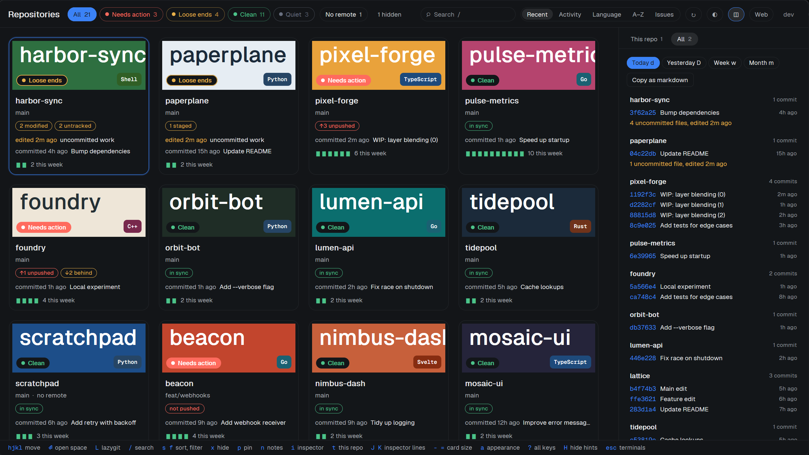

# RepoDash

Every git repo on your machine as a card in the Herdr desktop app: its status (needs action,
loose ends, clean, quiet), branch, uncommitted files, last commit, next GitHub issue and the
agent working in it. Double-click a card to land in that repo's space, or make one there.



## Install

RepoDash is a program (one static binary) plus this mod. The program scans the repos; the mod
draws them. The usual way installs both:

```sh
curl -fsSL https://github.com/ezjones/repodash/releases/latest/download/install.sh | sh
```

On Windows run that inside WSL: it installs the program there and the mod into the Windows
user's `~/.config/herdr-app`. `repodash -install-desktop` adds or updates the mod on its own;
`repodash -uninstall-desktop` removes it. Neither touches your `keys.json` or layouts.

**In the sidebar.** The dialog's `⋯` menu (top right) adds RepoDash to a layout, always as a new
copy made with Herdr's own `layout.clone`, so the layouts you have stay as they are:

- **RepoDash layout**: a copy of Herdr's `main` named `repodash`, with a RepoDash tile under the
  sidebar's top row ("Repositories", the repo count, how many need action) and the cards in
  place of the terminals. The tile switches between the cards and the terminals; picking a
  space or tab shows its terminals.
- **Add to sidebar**: a copy of the layout you're on, named `<layout>-repodash`, with only the
  tile, which opens the dialog.
- **Back to `<layout>`** switches back (`ctrl-shift-l` does too). A copy doesn't follow later
  changes to the layout it came from; delete its file in `layouts/` to remove it.

The same as keys: `repodash:layout` and `repodash:sidebar` (with the dialog open).

By hand (an agent following Herdr's guide): copy `mods/repodash/` into `mods/`, then write
`mods/repodash/config.json` with `{"bin": "<absolute path of repodash on the repos' machine>"}`.

**What it does on your machine.** It reaches the network (the RepoDash server at
`http://127.0.0.1:8092`, and links you open), and runs programs: `hc` (to start the server and
lazygit as herdr-core terminals), `sh` (to find the binary and read RepoDash's issues cache),
`curl` (to download cover images into its own `.covers/`), `lazygit`, and your system's URL
opener. It reads and writes only RepoDash's own data through the server (hide, pin, notes).

## What you see

- Opened with `mod.open:repodash` (the keys.json here binds `ctrl-shift-r`), a dialog 94% x
  92% of the window; or from the RepoDash tile in the sidebar (see Install).
- **Top bar**, one line: "Repositories"; status filters as pills (All, Needs action red, Loose
  ends amber, Clean green, Quiet grey, each with its count); "No remote N"; "N hidden"; the
  agents summary ("2 working · 1 waiting"); search (`/`); sort segment (Recent, Activity,
  Language, A-Z, Issues); refresh ↻; Appearance ◐; inspector ◫; Web; a ⚠ count when
  RepoDash's settings have problems; "↑ vX.Y.Z" when an update is offered; `⋯` (What's new,
  the layout choices). When narrower it folds instead of wrapping: sorts become a menu, then
  the tools a `⋯` menu, then the filters lose their words and become a menu.
- **Key hints** along the bottom (`H` hides them).
- **Cards**, from the top left, all one width (180-520 px, default 280, the Appearance slider or
  `-`/`=`). Everything in a card scales with that width. A card: a cover band 98 px tall at
  280 (the repo's image filled and cropped, a logo contained, or generated art: aurora, deep,
  gradient, or the name on a flat colour), a status pill at its lower left, the main language
  at its lower right; the name (📌 when pinned), "space" when a Herdr space is open there, the
  agent's state and context size; branch · worktrees · "no remote"; your note; chips (↑ unpushed,
  conflicts, ↓ behind, staged, modified, untracked, stashes, or "in sync"); last edit and commit;
  "Next #N" issue; a bar of this week's commits. Selected: accent border with a soft halo.
- **Inspector** (380 px, right): tabs This repo / All. This repo: status and why, branch and
  path, buttons (Go to / New space, Lazygit, GitHub, Copy cd, Notes, Pin, Hide), space, agent,
  activity, the 5 latest commits (click: author, date, body, files, GitHub link), open issues,
  worktrees (click: a space there; "lazygit" there), notes. All: work in every repo today,
  yesterday, this week or this month, with Copy as markdown.
- **Dialogs**: README and notes (`n`; notes edit in Herdr's editor, ctrl-s saves), lazygit
  (92% x 90%, a title bar with ✕), keys (`?`), What's new, settings problems; the Appearance
  popup (cover style tiles, covers on/off, language badge, card size slider, each card section).

## How it behaves

- Agent states: working (a braille spinner, the theme's working colour), blocked ("waiting",
  pulsing dot), done, idle (dot). From Herdr's agents, matched to repos by folder; else what
  RepoDash sees in tmux.
- Keys: `h j k l`/arrows move, `g`/`G`, `ctrl-d`/`ctrl-u`, Enter/`c`/double-click go to the
  repo's space (making one on the repos' machine), `L` lazygit, `/` search, `s`/`S` sort and
  reverse, `f`/`F` filter, `x` hide/unhide (shared with RepoDash's TUI and web page), `X` only
  the hidden repos, `p` pin, `n` notes, `r` rescan, `-`/`=` card size, `a` Appearance, `w` web
  page, `U` update, `?` keys, `i` inspector, `t` or `1`/`2` its tabs, `d D w m` All's range,
  `J`/`K` and `o` the inspector's lines, Esc back (closes the dialog).
- Data refreshes every 15 s while shown. When the server doesn't answer, the mod starts
  `<bin> -web -no-open` on the repos' machine once, as a herdr-core terminal with no pane.
- Closing lazygit or a dialog gives the keyboard back to the cards.

## Built from

- One mod, `repodash`, several parts by `props.part`: `dash` (default: cards and inspector),
  `nav` (a sidebar tile that flips a layout's `view` stack between `dash` and `main`), `look`
  (Appearance popup), `gitbar`, `notes`, `help`, `news`, `warnings`.
- `mod.json`: `{"place":"none","focusable":true,"overlay":{"kind":"dialog","width":0.94,"height":0.92}}`.
- A layout of your own can hold it: a stack `view` with children `dash` (block, mod `repodash`,
  props `{part:"dash"}`) and `main` (the tab block), plus a 64 px `{part:"nav"}` block in the
  sidebar; `layout.select {stack:"view", child:"dash"}` on a key.
- RepoDash's HTTP API: `/api/repos`, `/api/refresh`, `/api/config`, `/api/commits/<r>`,
  `/api/commit/<r>/<hash>`, `/api/info/<r>`, `/api/work`, `/api/update`, `/api/changelog`,
  `PUT /api/hidden/<r>`, `/api/pins/<r>`, `/api/notes/<r>`, `/img/<r>`.
- The layout choices: `layout.clone` (`main` or the shown layout, as a new name), then
  `layout.set` with the tile inserted after the sidebar's `brand` block (and, for the RepoDash
  layout, the `{tab:"active"}` block wrapped in the `view` stack), then `layout.switch` back.
  Never `layout.set` on a layout it didn't just copy.
- `herdr`: `spaces`, `panes`, `agents`, `machines`, `focused`, `layout`, `layouts`, `theme`, `settings`,
  `window().platform`, `run` (`space.select`, `space.new`, `layout.select`, `layout.clone`,
  `layout.set`, `layout.switch`, `mod.open`, `terminal.kill`),
  `hc run`, `exec`, `openOverlay`/`closeOverlay`, `shared`/`setShared`, `nextCommand`, `notify`.
- Art: the web page's cover generators ported to SVG files in `.covers/`; `icon.svg`.

## Watch out

- On Windows, RepoDash runs in WSL, which Herdr reaches as a machine of its own; the mod finds
  it by looking for the binary on each machine. Windows must reach WSL's `127.0.0.1` (WSL's
  default localhost forwarding, or mirrored networking).
- gpui-base's `Slider` closed the whole window when it opened in the popup; the slider is drawn
  from plain elements. `image()` has no object-fit: cover images are sized from their own
  header bytes and cropped by the band.
- `on_size_change` sizes are not in drawn units under zoom: a 100 px probe converts them.
- A copy in a hidden tab keeps its timers; the dialog copy only lives while open.
- No canvas or kanban view yet (the web page has both).

## Done when

- `herdr-app check mods/repodash` passes.
- `mod.open:repodash` shows the repos of a running `repodash -web`; with none running, it
  starts one and shows the cards within a few seconds.
- Double-clicking a card selects that repo's space, or makes one in its folder.
- `x` hides the selected repo in this view, RepoDash's TUI and its web page alike.
- `L` opens lazygit in the repo; `q` closes it and `j`/`k` move the cards again.
- `⋯` > RepoDash layout makes `layouts/repodash.json` and shows the tile and the cards; `⋯` >
  Add to sidebar on `main` makes `layouts/main-repodash.json` with the tile; Herdr's `main`
  is unchanged; Back to main returns.
